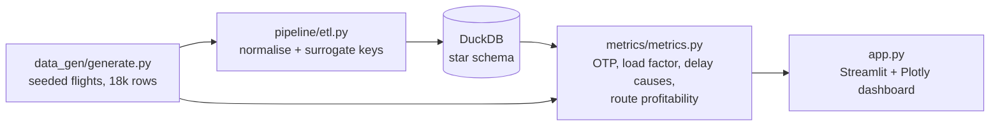

# ✈️ Airline Operations Dashboard

[](https://www.python.org/)
[](https://streamlit.io/)
[](https://duckdb.org/)
[]()
[]()

**Live demo:** https://airline-operations-dashboard.streamlit.app

A Business Intelligence dashboard for airline operations: seeded synthetic
flight operations (12 months, ~18,000 flights, 8 airports, 30 routes,
3 carriers) flow through an ETL pipeline into a DuckDB star schema, a
metrics layer computes DOT-aligned operational KPIs, and a Streamlit +
Plotly dashboard presents them. Deterministic seed, no API keys, no
downloads, no real airline data.

## Features

- **KPI row with month-over-month deltas** — on-time performance (A14),
  completion factor, average load factor, cancellation rate, and delay
  minutes per flight for the latest month vs the prior month.
- **OTP trend by carrier** — monthly on-time performance with an 80%
  reference line; the DOT 15-minute threshold is the on-time cutoff.
- **Delay-cause breakdown** — carrier / weather / NAS / late-aircraft
  shares of delay minutes (DOT categories), overall and by carrier.
- **Route profitability table** — revenue-vs-cost proxy per route with
  load factor and OTP alongside, so a "profitable but unreliable" route
  is visible instead of hidden.
- **Load-factor heatmap** — route × month load factor, showing seasonal
  demand peaks and troughs.
- **Seasonal demand chart** — monthly passengers and flights, with peak
  and trough months annotated.
- **Flight drilldown table** — searchable, sortable flight-level view
  (carrier, route, scheduled/actual times, delay minutes and cause,
  status).

## Architecture



## KPI definitions

| KPI | Definition |
| --- | --- |
| OTP (A14) | On-time arrivals (arrival delay < 15 min) / **completed** flights. Cancelled flights are excluded from numerator and denominator. |
| Completion factor | Completed flights / all scheduled flights |
| Cancellation rate | Cancelled flights / all scheduled flights |
| Load factor | Passengers / seats, completed flights only |
| Delay-cause shares | Share of delay minutes per DOT cause, over delayed flights (arrival delay ≥ 15 min) only, so shares sum to 1.0 |
| Route profit proxy | Revenue (passengers × base fare) − cost proxy (seats × $85 + delay minutes × $35). A ranking proxy, not accounting profit. |

## Quickstart

```bash
git clone https://github.com/ShivakrishnaMacha/airline-operations-dashboard.git
cd airline-operations-dashboard
pip install -r requirements.txt

# Build the DuckDB star schema
python -m pipeline.etl

# Run the dashboard
streamlit run app.py

# Run the tests
pytest -q
```

Or with Docker:

```bash
docker build -t airline-operations-dashboard .
docker run -p 8501:8501 airline-operations-dashboard
```

## Project structure

```
airline-operations-dashboard/
├── data_gen/generate.py      # seeded flights: scheduled/actual times, carrier,
│                             # origin/destination, aircraft, seats, passengers,
│                             # delay minutes by DOT cause, cancellations
├── pipeline/etl.py           # normalise → star schema in DuckDB
├── pipeline/schema.sql       # DDL for the star schema (documented dbt-model mapping)
├── metrics/metrics.py        # OTP (A14), load factor, completion factor,
│                             # delay-cause shares, route profitability proxy,
│                             # seasonal demand
├── app.py                    # Streamlit dashboard (7 panels)
├── tests/test_metrics.py     # 9 tests: OTP arithmetic, load-factor bounds,
│                             # delay-cause shares sum to 1, cancelled flights
│                             # excluded from OTP, no negative passengers
├── requirements.txt
├── Dockerfile
├── .gitignore
└── README.md
```

## Production extensions

- Replace the seeded generator with a real feed (DOT BTS On-Time data or
  an airline AOC feed) behind the same `generate_flights` interface, and
  schedule the ETL with Airflow on a daily partition.
- Promote the DuckDB star schema to dbt models on Snowflake/BigQuery
  using the documented mapping in `pipeline/schema.sql`, with dbt tests
  on the OTP exclusion rule and the delay-cause sum-to-1 invariant.
- Add data-quality checks (Great Expectations / dbt tests) for
  passengers ≤ seats, non-negative delays on completed flights, and
  referential integrity between fact and dimensions.
- Add alerting on OTP or completion-factor drops by carrier/airport,
  and a forecasting layer for seasonal demand and delay risk.
- Cache the dashboard query layer and move the drilldown to paginated
  SQL against the warehouse once flight volumes leave the demo scale.

## License

MIT
